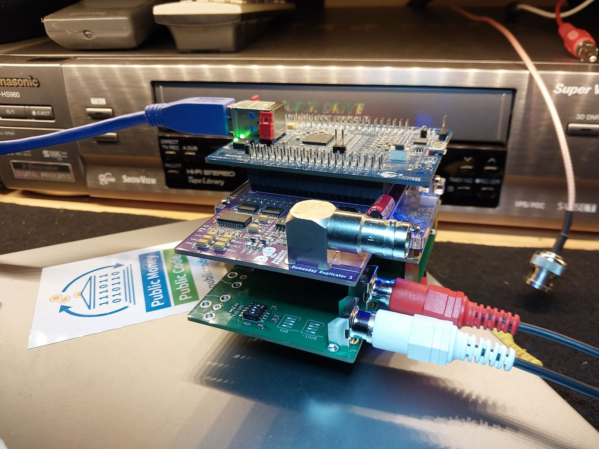
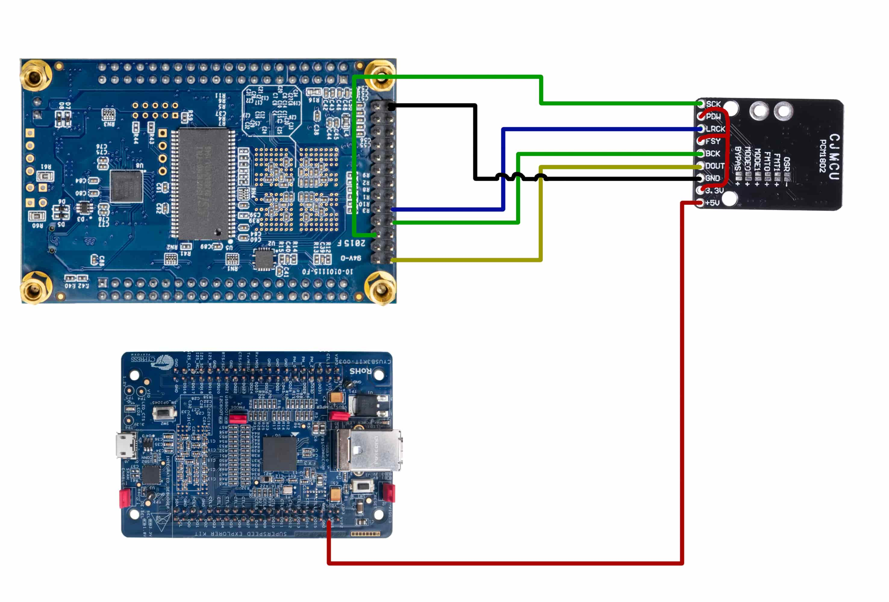
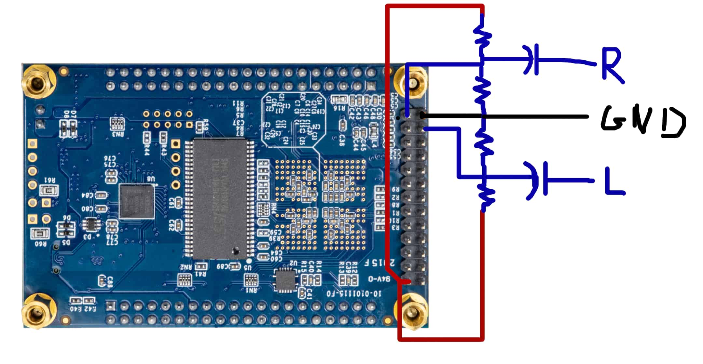
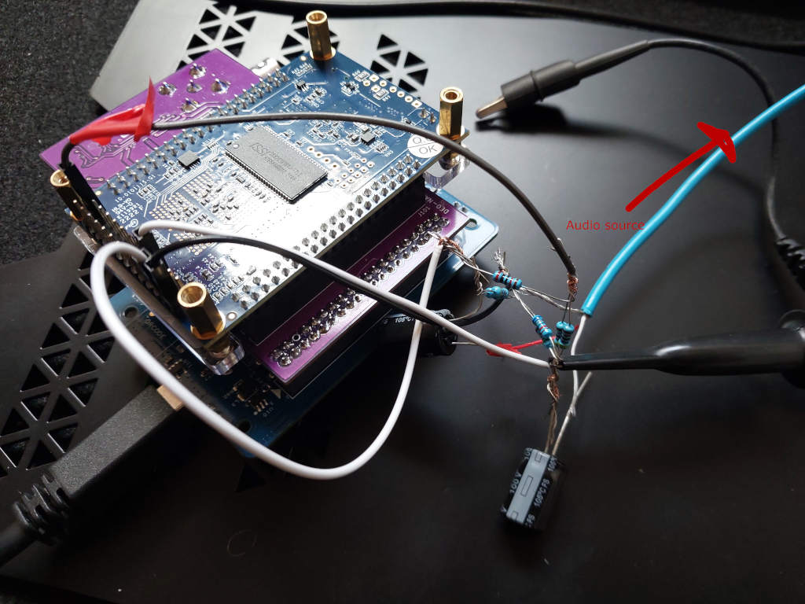

# Audio capture and the PCM1802 add-on board

The Domesday Duplicator can record a player's baseband analogue audio at the same time as the
RF, written to separate files next to the RF capture. The audio is sampled in lock-step with
the RF: the gateware reads the audio converters once per 512-sample frame of the RF stream,
so the two can be lined up exactly afterwards without any clock-drift correction.

This needs three things:

1. one or both audio converters connected to the DE0-NANO (below);
2. the audio-capable application gateware, which sends the RF stream in the framed sample
   format (specified with the gateware, under [fpga/](../../fpga/)) instead of the plain
   sequence-counter format;
3. the capture application, with **File → Settings → Capture → Audio** set to the converters
   in use (or `--audio-source` on the command line).

With gateware that does not send the framed format, the capture application captures RF
exactly as before and reports that audio is not available from the device.

## Converters

There are two, and they can be used together for four channels.

| | PCM1802 | ADC128S022 |
| --- | --- | --- |
| Where | External — this add-on board, or a low-cost module | Already on the DE0-NANO |
| Resolution | 24-bit | 12-bit |
| Quality | The one to use | Noise floor around −40 dB; a fallback |
| Output file | `<capture>_audio_external_adc.s24` | `<capture>_audio_integrated_adc.s16` |

Both files are headerless, little-endian, interleaved stereo (left first). The sample rate is
the RF sample rate divided by 512: **78125 Hz** for a 40 MSPS capture, and **39062.5 Hz** when
the gateware's 2:1 decimation (20 MSPS) is on. The capture's metadata records the exact rate.

## The add-on board

This directory holds the design of a small board that plugs onto the DE0-NANO's 2x13 header
(JP3) and carries both audio paths:

- the **PCM1802** with RCA inputs, its own supply regulator and a DIP switch for a −10 dB
  input pad;
- RCA inputs and the bias network for the DE0-NANO's own **ADC128S022**.

| Path | Contents |
| --- | --- |
| `audio-addon-board-pcm1802.kicad_pro` / `.kicad_sch` / `.kicad_pcb` | KiCad 9 project: schematic and layout |
| `audio-addon-board-pcm1802-rounded.*` | The same layout with rounded tracks, generated by the round-tracks plugin |
| `parts/` | Symbols, footprints and 3D models that are not in the KiCad standard libraries |
| `production/` | Fabrication outputs for the built board: BOM, placement, designators and IPC netlist |
| `fabrication-toolkit-options.json`, `*.round-tracks-config` | Settings for the KiCad plugins that produced the above |
| `images/` | The photographs and wiring diagrams on this page |

### Connection to the DE0-NANO

All signals use the DE0-NANO's 2x13 header (JP3); nothing on the Duplicator main board
changes.

| Signal | Direction | JP3 pin | FPGA port | FPGA pin |
| --- | --- | --- | --- | --- |
| PCM1802 SCKI (system clock, 256·fs) | FPGA → ADC | 5 | `GPIO_2[0]` | `PIN_A14` |
| PCM1802 BCK (bit clock, 64·fs) | FPGA → ADC | 8 | `GPIO_2[3]` | `PIN_C16` |
| PCM1802 LRCK (frame clock, fs; high = left) | FPGA → ADC | 10 | `GPIO_2[5]` | `PIN_D16` |
| PCM1802 DOUT (data) | ADC → FPGA | 2 | `GPIO_2_IN[0]` | `PIN_E15` |
| ADC128S022 left input | analogue | — | `Analog_In0` | on-board ADC |
| ADC128S022 right input | analogue | — | `Analog_In1` | on-board ADC |

The PCM1802 runs in slave mode with left-justified 24-bit data, which is what its format and
mode pins select when left at their defaults.

## Without the board

### A PCM1802 module on jumper wires

The common low-cost PCM1802 module works. Keep the wires between the module and the
DE0-NANO as short as possible.

| Module pin | Connect to |
| --- | --- |
| SCK | JP3 pin 5 |
| BCK | JP3 pin 8 |
| LRCK | JP3 pin 10 |
| DOUT | JP3 pin 2 |
| GND | GND |
| +5V | a 5 V supply (the diagram takes it from the FX3 board) |

- **PDW and FSY must be tied to 3.3 V** (the module's own 3.3 V pin). Check that the module's
  3.3 V regulator is actually producing 3.3 V.
- FMT0/FMT1, MODE0/MODE1, OSR and BYPASS need no wiring.
- Connect the audio source to the module's LIN, RIN and GND.

### The on-board ADC128S022

Each channel needs two resistors as a divider from the header's 3.3 V to GND, biasing the
input at mid-supply, and a capacitor coupling the audio into the midpoint. Any resistor value
from 1 kΩ to 10 kΩ and any capacitor from 1 µF to 10 µF works, but use the same values for
every part. Left is `Analog_In0` and right is `Analog_In1`.

## In the capture application

**File → Settings → Capture → Audio** selects none, the integrated ADC (ADC128S022), the
external ADC (PCM1802), or both. The statistics panel shows the levels and clipping counts of the audio
being captured, and which stream format the device is sending.

A capture from framed-format gateware also carries a 48-bit sample counter, which is what
proves the capture has no gaps. By default a gap stops the capture, as it does for the
standard gateware. **Continue after dropped samples** (in the same settings page, or
`--on-dropped-samples continue`) instead counts the loss, resynchronises on the next frame and
carries on.

## Licence

The hardware design is licensed under **Creative Commons Attribution-ShareAlike 4.0
International**, the same as the main board. The full text is in
[../pcb/LICENSE.txt](../pcb/LICENSE.txt).
